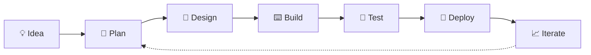

<!-- Suleman Sadat — GitHub Profile README -->

<div align="center">


<picture>
  <source media="(prefers-color-scheme: dark)" srcset="https://readme-typing-svg.demolab.com?font=Poppins&weight=600&size=20&duration=2800&pause=900&color=A5B4FC&center=true&vCenter=true&width=520&height=50&lines=From+idea+%E2%86%92+production;Web+apps+%26+SaaS+that+scale;AI+workflows+that+actually+ship;Clean+code.+Calm+deploys." />
  <source media="(prefers-color-scheme: light)" srcset="https://readme-typing-svg.demolab.com?font=Poppins&weight=600&size=20&duration=2800&pause=900&color=6D28D9&center=true&vCenter=true&width=520&height=50&lines=From+idea+%E2%86%92+production;Web+apps+%26+SaaS+that+scale;AI+workflows+that+actually+ship;Clean+code.+Calm+deploys." />
  
</picture>

<br/>


[**🚀 Explore my work**](https://github.com/SulemanSadat?tab=repositories)

</div>

---

## 🧑‍💻 `whoami`

```ts
const suleman = {
  role: "Full-Stack Developer",
  experience: "4+ years",
  clients: "Startups & international teams",
  mindset: "Product first, code second (but never sloppy)",
  stack: ["React", "Next.js", "TypeScript", "Python", "PHP/Laravel"],
  superpower: "Turning fuzzy ideas into shipped products",
  currentlyExploring: ["AI agents", "n8n automation", "Three.js"],
  funFact: "I debug best with a second cup of coffee ☕",
};
```

---

## 🛠️ What I build

| | |
|---|---|
| 🧱 **Product development** | Responsive, scalable apps, from concept to launch |
| ⚙️ **Backend systems** | Reliable APIs, clean data models, solid integrations |
| 🤖 **Intelligent workflows** | AI and automation wired into real product needs |
| 🚢 **Delivery** | Thoughtful architecture, thorough testing, shipping with distributed teams |

### 🔄 How I work



---

## ⚙️ Tech arsenal

<p align="center">
  
  
  
  
  
  
  
  
  
  
  
  
  
  
</p>
<p align="center">
  
  
  
  
  
  
  
  
  
  
  <picture>
    <source media="(prefers-color-scheme: dark)" srcset="https://cdn.simpleicons.org/threedotjs/FFFFFF" />
    <source media="(prefers-color-scheme: light)" srcset="https://cdn.simpleicons.org/threedotjs/171717" />
    
  </picture>
  
  
  
</p>

---

## 🚀 Career log

<details open>
<summary><b>⚡ Full-Stack Developer — MobiMix Ltd</b> &nbsp;·&nbsp; <i>React · Python · JavaScript · PHP</i></summary>
<br/>

- Supported delivery from planning and development through testing and deployment in an Agile/Scrum environment.
- Contributed to delivery improvements that helped the team complete projects **65% faster**.
- Mentored junior developers and promoted collaborative engineering practices.

</details>

<details open>
<summary><b>🌍 Full-Stack Developer — Freelance</b> &nbsp;·&nbsp; <i>React · Next.js · Laravel · Docker · n8n</i></summary>
<br/>

- Built and delivered full-stack applications for international clients: interfaces, backend services, testing and deployment.
- Focused on scalable implementation, maintainability, and reliability after release.

</details>

### 🎓 Certification


---

## 📊 GitHub stats

<div align="center">

<picture>
  <source media="(prefers-color-scheme: dark)" srcset="https://github-readme-stats.vercel.app/api?username=SulemanSadat&show_icons=true&theme=tokyonight&hide_border=true&bg_color=0d1117" />
  
</picture>
<picture>
  <source media="(prefers-color-scheme: dark)" srcset="https://github-readme-stats.vercel.app/api/top-langs/?username=SulemanSadat&layout=compact&theme=tokyonight&hide_border=true&bg_color=0d1117" />
  
</picture>

<br/>

<picture>
  <source media="(prefers-color-scheme: dark)" srcset="https://streak-stats.demolab.com?user=SulemanSadat&theme=tokyonight&hide_border=true&background=0d1117" />
  
</picture>

</div>

---

## 🤝 Let's build something

<div align="center">

> *"Ship it small, ship it solid, then make it better."*

[](https://github.com/SulemanSadat)
[](https://github.com/SulemanSadat?tab=repositories)


</div>
